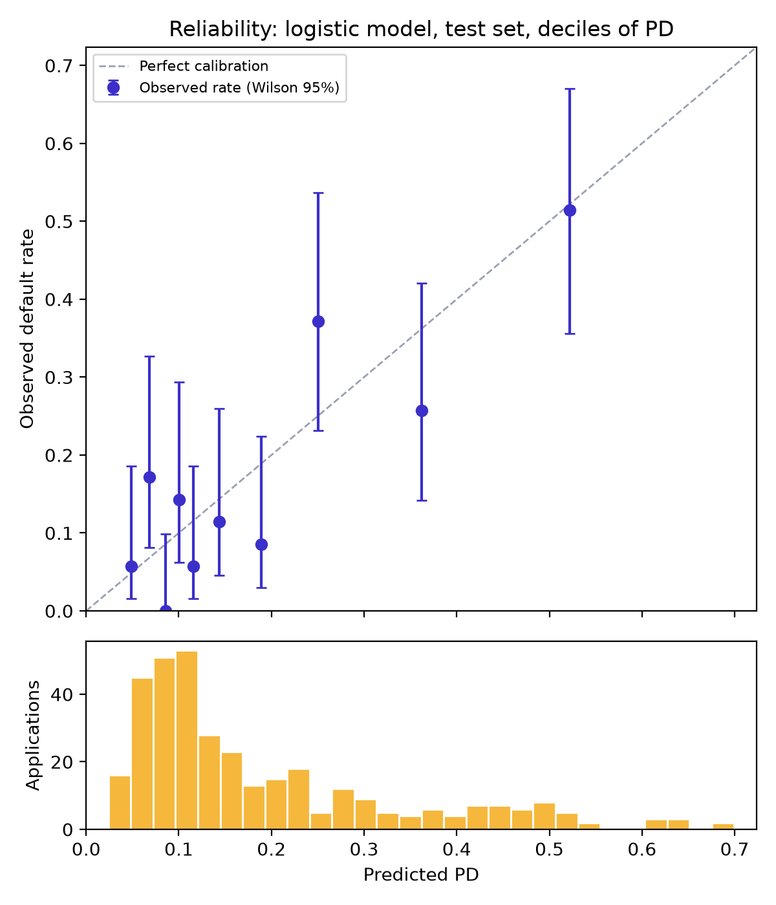
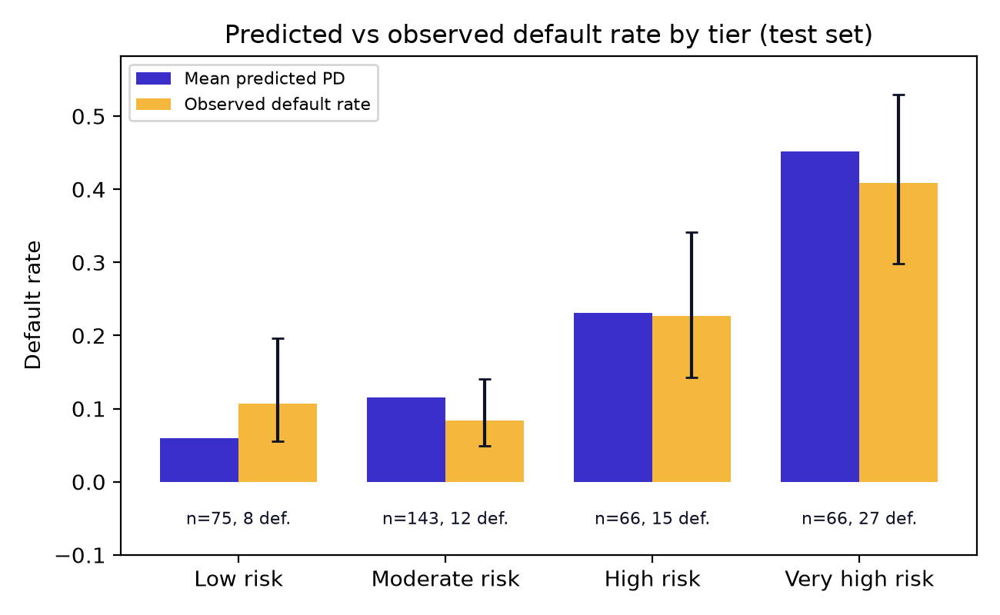
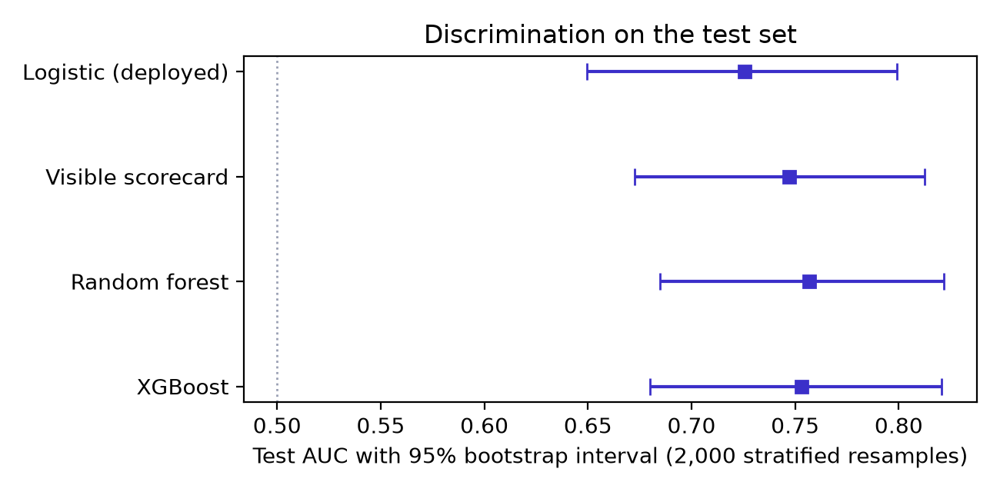

# Calibration and uncertainty report

Evaluation only: the deployed logistic model (`models/logistic.joblib`), its 52 features, the score formula and the tier thresholds are unchanged. Produced by `python -m src.evaluate_calibration` (seed 42; numbers in `reports/calibration/`). **All outcomes are simulated**, so these numbers describe how well the model recovers the synthetic default, not how it would perform on real borrowers.

Test set: 350 applications from 151 vendors, 62 defaults (17.7%). Same vendor split as `docs/model_report.md`.

## Verdict

- **Calibration: well calibrated within the uncertainty of the data.**
- No overall bias: calibration-in-the-large -0.09 (-0.38 to 0.21) on the test set; mean predicted PD 18.9% against an observed 17.7%.
- No clear over- or under-spread: calibration slope 0.89 (0.58 to 1.20) on the test set, 0.93 out-of-fold and 1.36 on validation; every interval includes 1.
- Flags: Hosmer-Lemeshow p below 0.05 on the test set; the test set is under-predicted in decile 2; tiers out of order on the test set; Low risk on the test set has an observed rate of 10.7%, outside its 0% to 8% band, though its 95% interval (5.5% to 19.7%) overlaps the band. Each appears in one sample only and not in the others, so it is read as sampling noise in a 62-default test set, not a property of the model.
- Tiers in order (observed default rate rising from Low to Very high risk): test set **no**, out-of-fold training sample yes, validation set yes.
- Discrimination: logistic test AUC 0.726 (0.650 to 0.799). Every paired difference with the other models has an interval that includes 0, so the data do not support ranking the models.

## What each number means

| Metric | In one sentence |
|---|---|
| AUC | The chance that a randomly chosen defaulter gets a higher PD than a randomly chosen non-defaulter (0.5 = coin toss, 1 = perfect ranking). |
| Gini | 2 x AUC - 1, the same ranking quality on a 0 to 1 scale. |
| KS | The largest gap between the PD distributions of defaulters and non-defaulters. |
| Brier score | The mean squared gap between the PD and the 0/1 outcome (lower is better). |
| Brier skill score | How much better the Brier score is than always predicting the training default rate (0 = no better, 1 = perfect). |
| Log loss | The average penalty for confident wrong predictions (lower is better). |
| Calibration slope | Below 1: predictions too extreme; above 1: too timid; 1 is ideal. |
| Calibration-in-the-large | Above 0: the model predicts too little default overall; below 0: too much; 0 is ideal. |
| Hosmer-Lemeshow | A chi-square test of predicted vs observed defaults across 10 groups; indicative only with this few defaults. |
| ECE | The average gap between predicted and observed default rates over 10 equal-size groups. |
| Wilson interval | A 95% interval for an observed rate that behaves well with small counts. |

## Discrimination (test set)

95% percentile intervals from 2,000 bootstrap resamples stratified by outcome; the differences are paired (every model scored on the same resamples).

| Model | Test AUC | 95% interval | Difference vs logistic | 95% interval | Includes 0 |
|---|---|---|---|---|---|
| Logistic (deployed) | 0.726 | 0.650 to 0.799 | - | - | - |
| Visible scorecard | 0.747 | 0.672 to 0.812 | -0.021 | -0.053 to +0.008 | yes |
| Random forest | 0.757 | 0.685 to 0.822 | -0.031 | -0.077 to +0.012 | yes |
| XGBoost | 0.753 | 0.680 to 0.821 | -0.028 | -0.072 to +0.012 | yes |

The visible scorecard is the rule the synthetic defaults were drawn from (without its hidden terms), scored with no fitting, so it is close to the best ranking the visible data allow; it is a ceiling to compare with, not a competing model.

Logistic: KS 0.440, Gini 0.451. Resampling whole vendors instead (as `docs/model_report.md` does, because one vendor's applications are not independent) gives a wider interval: 0.638 to 0.808.

## Calibration of the PD

| | Test set | Out-of-fold, training vendors | Validation set |
|---|---|---|---|
| Applications (defaults) | 350 (62) | 1579 (287) | 332 (62) |
| Observed default rate | 17.7% | 18.2% | 18.7% |
| Mean predicted PD | 18.9% | 18.2% | 17.7% |
| Brier score | 0.1295 | 0.1320 | 0.1202 |
| Brier, constant 18.2% (training default rate) | 0.1458 | 0.1487 | 0.1519 |
| Brier skill score | 0.112 | 0.112 | 0.209 |
| Log loss | 0.419 | 0.424 | 0.392 |
| Calibration intercept (slope free) | -0.22 (-0.71 to 0.26) | -0.10 (-0.34 to 0.14) | 0.55 (-0.03 to 1.13) |
| Calibration slope | 0.89 (0.58 to 1.20) | 0.93 (0.77 to 1.08) | 1.36 (0.98 to 1.74) |
| Calibration-in-the-large | -0.09 (-0.38 to 0.21) | -0.00 (-0.14 to 0.13) | 0.07 (-0.22 to 0.37) |
| Hosmer-Lemeshow (10 groups, 8 df), indicative | 18.2, p = 0.020 | 5.9, p = 0.661 | 9.8, p = 0.278 |
| ECE (10 equal-count bins) | 0.067 | 0.013 | 0.049 |

- **Test set**: the deployed model on the test vendors (as in `docs/model_report.md`).
- **Out-of-fold, training vendors**: the same logistic pipeline and settings refitted in 5 grouped folds of the training vendors, so every training application gets a prediction from a model that did not see it. A larger sample for the calibration check; temporary fits, not the deployed model.
- **Validation set**: the deployed model on the validation vendors, which it never trained on (they were used only for reporting and lender cut-offs). A second independent holdout of the same size as the test set.

### By decile of predicted PD (test set)

| Decile | n | Defaults | Mean predicted PD | Observed rate | Wilson 95% | Predicted inside interval |
|---|---|---|---|---|---|---|
| 1 | 35 | 2 | 4.8% | 5.7% | 1.6% to 18.6% | yes |
| 2 | 35 | 6 | 6.8% | 17.1% | 8.1% to 32.7% | **no** |
| 3 | 35 | 0 | 8.6% | 0.0% | 0.0% to 9.9% | yes |
| 4 | 35 | 5 | 10.0% | 14.3% | 6.3% to 29.4% | yes |
| 5 | 35 | 2 | 11.6% | 5.7% | 1.6% to 18.6% | yes |
| 6 | 35 | 4 | 14.3% | 11.4% | 4.5% to 26.0% | yes |
| 7 | 35 | 3 | 18.9% | 8.6% | 3.0% to 22.4% | yes |
| 8 | 35 | 13 | 25.0% | 37.1% | 23.2% to 53.7% | yes |
| 9 | 35 | 9 | 36.2% | 25.7% | 14.2% to 42.1% | yes |
| 10 | 35 | 18 | 52.2% | 51.4% | 35.6% to 67.0% | yes |

### By decile of predicted PD (out-of-fold, training vendors)

| Decile | n | Defaults | Mean predicted PD | Observed rate | Wilson 95% | Predicted inside interval |
|---|---|---|---|---|---|---|
| 1 | 158 | 12 | 4.9% | 7.6% | 4.4% to 12.8% | yes |
| 2 | 158 | 11 | 6.7% | 7.0% | 3.9% to 12.0% | yes |
| 3 | 158 | 17 | 8.2% | 10.8% | 6.8% to 16.6% | yes |
| 4 | 158 | 11 | 9.9% | 7.0% | 3.9% to 12.0% | yes |
| 5 | 158 | 18 | 12.0% | 11.4% | 7.3% to 17.3% | yes |
| 6 | 158 | 24 | 14.6% | 15.2% | 10.4% to 21.6% | yes |
| 7 | 158 | 29 | 18.6% | 18.4% | 13.1% to 25.1% | yes |
| 8 | 158 | 37 | 24.8% | 23.4% | 17.5% to 30.6% | yes |
| 9 | 158 | 52 | 33.3% | 32.9% | 26.1% to 40.6% | yes |
| 10 | 157 | 76 | 49.4% | 48.4% | 40.7% to 56.2% | yes |

## By app tier

Tiers come from `scoring.TIER_BANDS` and `scoring.risk_tier` (imported, not copied). "Outside band" means the observed rate is outside the tier's PD band; "interval misses band" means even its 95% interval does.

| Sample | Tier | PD band | n | Defaults | Mean predicted PD | Observed rate | Wilson 95% | Outside band | Interval misses band |
|---|---|---|---|---|---|---|---|---|---|
| Test | Low risk | 0% to 8% | 75 | 8 | 6.0% | 10.7% | 5.5% to 19.7% | **yes** | no |
| Test | Moderate risk | 8% to 17% | 143 | 12 | 11.5% | 8.4% | 4.9% to 14.1% | no | no |
| Test | High risk | 17% to 30% | 66 | 15 | 23.1% | 22.7% | 14.3% to 34.2% | no | no |
| Test | Very high risk | 30% to 100% | 66 | 27 | 45.1% | 40.9% | 29.9% to 53.0% | no | no |
| OOF train | Low risk | 0% to 8% | 369 | 28 | 6.0% | 7.6% | 5.3% to 10.7% | no | no |
| OOF train | Moderate risk | 8% to 17% | 607 | 69 | 11.7% | 11.4% | 9.1% to 14.1% | no | no |
| OOF train | High risk | 17% to 30% | 313 | 71 | 22.8% | 22.7% | 18.4% to 27.6% | no | no |
| OOF train | Very high risk | 30% to 100% | 290 | 119 | 42.4% | 41.0% | 35.5% to 46.8% | no | no |
| Validation | Low risk | 0% to 8% | 81 | 3 | 6.2% | 3.7% | 1.3% to 10.3% | no | no |
| Validation | Moderate risk | 8% to 17% | 130 | 16 | 11.8% | 12.3% | 7.7% to 19.1% | no | no |
| Validation | High risk | 17% to 30% | 64 | 12 | 22.3% | 18.8% | 11.1% to 30.0% | no | no |
| Validation | Very high risk | 30% to 100% | 57 | 31 | 42.5% | 54.4% | 41.6% to 66.6% | no | no |

Monotonicity: the observed default rate should rise from Low to Very high risk (fall as the score rises).

- Test set: 10.7%, 8.4%, 22.7%, 40.9%: **does not rise at every step.**
- Out-of-fold training sample: 7.6%, 11.4%, 22.7%, 41.0%: rises at every step.
- Validation set: 3.7%, 12.3%, 18.8%, 54.4%: rises at every step.

## Score formula

`600 + 50 x log2(((1 - PD) / PD) / 5)`, rounded and clipped to 300-850, written out independently, gives exactly the scores of `scoring.pd_to_score` for all 350 test PDs (largest difference 0 points). The data hold no separately stored test-set scores, so this compares the formula with the code that the app uses.

| Tier boundary PD | Exact score | Rounded score | First score always in the lower-risk tier | Rounded score shared by both tiers |
|---|---|---|---|---|
| 8% | 660.08 | 660 | 661 | yes |
| 17% | 598.28 | 598 | 599 | yes |
| 30% | 545.02 | 545 | 546 | yes |

Tiers are assigned from the PD, not from the rounded score. A PD just under a boundary and the boundary PD itself round to the same score, so one score per boundary can belong to either tier (cosmetic: at most a one-point overlap). On the test set, 2 application(s) sit on such a shared score.

## How much a small test set moves

AUC of the logistic model on each half of 5 stratified random 50/50 splits of the test set (about 175 applications and 31 defaults per half): mean 0.725, range 0.685 to 0.765.

## fuliza_late

`fuliza_late` is a post-application outcome (a Fuliza draw in the 60 days after the application still unpaid 30 days later). It is banned as an input in `train_models.py`, so the deployed model has no coefficient for it.

- Univariate AUC for default on the test set: 0.493 (0.451 to 0.543); on all 2261 rows: 0.497. The interval includes 0.5: no evidence it separates defaulters from non-defaulters.
- Diagnostic only: adding it to the logistic pipeline refitted on the training vendors gives a coefficient of +0.013, bootstrap 95% interval -0.025 to 0.046 (200 resamples); the interval includes 0. These refits are temporary objects, never saved, and fuliza_late must stay out of the model because it is only known after the loan.

## Recalibration

Not recommended on this evidence. If a later run shows a bias or slope problem that repeats across samples, Platt scaling fitted on the validation vendors is the first option. The rules behind the verdict are in `verdict()` in `src/evaluate_calibration.py`.

## Limits

- **The data are simulated.** Defaults are drawn from a known scorecard probability, so the model is recovering a synthetic rule. Nothing here says how it would perform on real vendors.
- **The test set has only 62 defaults.** Intervals are wide: a tier or decile holds a handful of defaults, the Hosmer-Lemeshow test is indicative only, and the half-sample AUCs above show how far one number can move.
- **Model ranking is not supported where intervals overlap.** The paired AUC differences are the right test, and an interval that includes 0 means the data cannot tell the models apart.
- The bootstrap resamples applications. One vendor can have up to 4 applications, which are not independent; the vendor-level interval above is the more cautious one.
